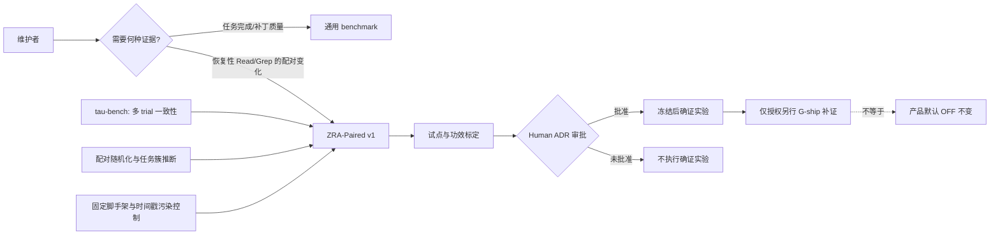
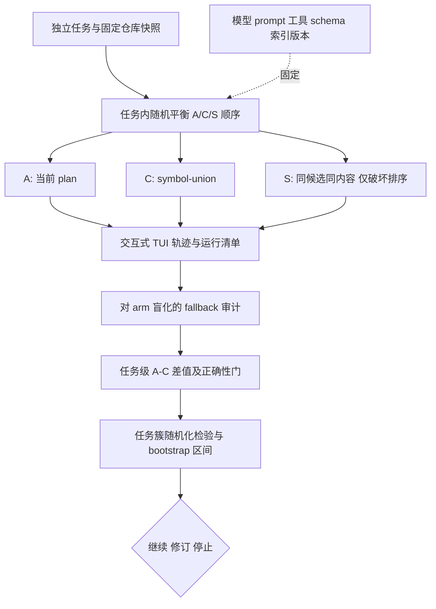

# 调研主题
检索工具对 Agent 任务表现的影响：ZRA-Paired v1 评估方法选型

推荐本仓定制的配对消融协议，而不是原生复用通用 Agent benchmark。借用 tau-bench 的多 trial 一致性、固定脚手架执行和配对统计方法，主估计量是 C 相对 baseline 每任务减少的经审计恢复性 Read/Grep；S 臂是保留候选集合的排序破坏诊断。任务而非 trial 是独立推断单元。最终 N、成本和协议修订均待试点与 ADR 审批，当前不授权产品默认行为。

## 输入材料与观察时间
Evidence ledger: `ebf25d63aad83e94f582c42e87b02882108d41baede56e65783965341d432903`
Observed: 2026-11-05T13:59:05.722Z

## Key-Value 概念索引
- Key: `user-and-baseline` — 维护者要判断 C 是否在交互式 Claude Code 中减少恢复性 Read/Grep。C 仅通过 ADR-0014 G-entry，尚无运行时切臂和审计后的主终点。[L-ADR14](docs/decisions/ZJ-0014-split-retrieval-gate-into-agent-entry-and-ship.md)
- Key: `target-estimand` — d_i=mean(A_i)-mean(C_i)，其中 A_i/C_i 是任务 i 各有效 trial 的恢复性 Read/Grep 次数；正值代表 C 有益。主统计量是对任务等权的 mean(d_i)，不是原始 Read/Grep，也不是离线 Hit@5。
- Key: `fit-model` — 通用 benchmark 的任务完成终点与本仓的工具行为终点不匹配；多 trial、固定变量、消融和配对推断是可迁移的单元能力。选用 native 的组件、adapted 的协议，而非整个 benchmark。
- Key: `ownership-model` — 本仓拥有任务选择、fallback 标注、切臂、盲审、统计代码、运行清单和停止判定；tau-bench/SWE-rebench 只提供方法证据。旧 parse-arms.mjs 只给原始计数，不是审计终点。[L-PARSER](scripts/agent-eval/parse-arms.mjs)
- Key: `execution-boundary` — 沿用 itrun.sh 的交互式 TUI，不换 headless；A/C/S 必须共享工具 schema、prompt、模型版本和索引。ZCG_RETRIEVAL_ARM 与 S 的序列化保持尚未实现，不能据此声称已可执行。[L-ITRUN](scripts/agent-eval/itrun.sh)
- Key: `freshness` — v3 永久冻结。新任务集记录来源、标注时间、审阅者与调参历史，尽量采用模型知识截止后的材料；独立标注降低选择泄漏，但不能证明训练零污染。[P-SWE-REBENCH](https://arxiv.org/html/2505.20411v2)
- Key: `statistical-unit` — 重复 trial 属于同一任务簇。主检验对任务级差值符号翻转做双侧配对随机化；任务簇 bootstrap 仅给效应区间。小样本下单独依赖 bootstrap 可能过度乐观。[P-IR-2009](https://dl.acm.org/doi/abs/10.1145/1571941.1572050)
- Key: `lifecycle` — usefulness-validation：先试点测量方差、缺失、顺序效应、审计一致性和成本，再冻结正式 N 与预算。5–8×4 是试点，不是显著性实验；40×4 也未获证据支持。
- Key: `guardrails` — 恢复性 Read/Grep 不是正确性的代理；每个任务保留预先定义的答案充分性规则，任何 C 正确性回退均停止产品化。合法深入、编辑准备和验证读取不计 fallback。[L-SUFFICIENCY](docs/contracts/baseline-agent-sufficiency-v1.md)
- Key: `causal-scope` — S 保持 C 的候选集合、条数、内容和 payload schema，只以固定种子置换排序。它诊断排序价值，但不能单独区分所有检索动作、反思和内容中介效应。[P-ADAPTIVE](https://arxiv.org/abs/2602.07213)
- Key: `protocol-change` — ADR-0013 原文要求配对 bootstrap 区间。若采纳本报告的任务簇区间+随机化主检验及三臂设计，必须先以新 ADR 明确修订，不能静默变更已 Accepted 门。
- Key: `security-and-isolation` — 现有 itrun.sh 使用 --dangerously-skip-permissions。实验限定于一次性只读仓库快照，任务禁止写入、网络检索现成答案及访问宿主凭据；每臂重置环境并保存版本与输出清单。该隔离尚需实现和验收。

Concepts: [[user-and-baseline]], [[target-estimand]], [[fit-model]], [[ownership-model]], [[execution-boundary]], [[freshness]], [[statistical-unit]], [[lifecycle]], [[guardrails]], [[causal-scope]], [[protocol-change]], [[security-and-isolation]]

## C4 System Landscape
### 方法选型与责任边界

## 候选项目表
| Repository | Stars | Topic match |
|---|---:|---:|
| SWE-bench/SWE-bench | 6149 | 0 |
| sierra-research/tau-bench | 1490 | 0 |
| THUDM/AgentBench | 3816 | 0 |
| OpenBMB/ToolBench | 5767 | 0 |
| open-compass/T-Eval | 313 | 0 |

## 深读项目卡片
### SWE-bench — 终点不匹配，不原生采用
sealed 证据仅显示其 harness 进行 patch grading 和报告，支持拒绝将它作为本问题的原生方法；不能从 ledger 推断它有配对、显著性或污染控制协议。角色=完整软件修复评估；主要缺口=终点与交互执行面不匹配。证据强度=有限仓库事实。

- Claim `swebench-scope`
- Claim `ledger-limits`

### tau-bench — 借用一致性，而非搬运任务终点
sealed 摘录只是论文链接与 API 设置；核心方法事实另见 P-TAU。原生提供 pass^k 和至少三次主实验 trial，但不评估恢复性 Read/Grep。角色=重复试验设计来源；主要缺口=终态 reward 不是本仓主终点。证据强度=论文强，sealed 方法覆盖弱。

- Claim `tau-repeated`
- Claim `tau-limits`
- Claim `ledger-limits`

### AgentBench — 通用环境过重
sealed 摘录仅证明存在多环境 Docker 执行，不证明配对或统计方法。角色=通用 Agent 环境；主要缺口=不是检索算法单变量消融，且统计和终点信息未知。证据强度=有限仓库事实。

- Claim `agentbench-scope`
- Claim `ledger-limits`

### ToolBench — 工具能力评估不是检索行为消融
sealed 证据描述 Pass Rate、Win Rate、重复评审和人工校验，但不等于同任务跨检索实现的 paired inference。角色=通用工具使用评估；主要缺口=主终点与执行面不同。证据强度=仓库事实中等，适配证据弱。

- Claim `toolbench-scope`
- Claim `ledger-limits`

### T-Eval — 保留为未知而非断言缺失
sealed 仅确认它是逐步工具能力评估 harness，paired-design、significance、endpoint、contamination 均 unknown。角色=工具能力分解参考；主要缺口=无法从本轮证据确认检索消融适配性，不原生采用。证据强度=低覆盖，明确不做 absent 推断。

- Claim `teval-scope`
- Claim `ledger-limits`

## 方案族及适用场景对比
### option-fit
约束=测量检索实现对 Agent 恢复行为的影响，而非重做离线召回或最终补丁质量。原生 SWE-bench/AgentBench/ToolBench/T-Eval 的任务面与终点不匹配，拒绝；tau-bench 只借多 trial 与一致性；本仓定制 ZRA-Paired 保留唯一变量和本仓主终点。

Claims: `swebench-scope`, `tau-repeated`, `agentbench-scope`, `toolbench-scope`, `teval-scope`

### endpoint-and-ownership
主终点=每任务恢复性 Read/Grep 的 A-C 均值差，正值有利于 C。分类、审计、答案充分性和异常保留由本仓负责。工具数、token、延迟和 raw Read/Grep 仅诊断；正确性是停止门。S 只作 C-S 的排序诊断，不替代 A-C 主对比。

Claims: `behavior-not-correctness`, `shuffle-diagnostic`

### statistical-design
试点每臂 k=4 估方差；确证优先 k=6 以任务内随机覆盖全部 A/C/S 排列，或预先声明平衡子集。主检验=双侧任务级符号翻转随机化，精确枚举或至少 100000 次固定种子模拟；区间=10000 次任务簇 bootstrap，不能将 trial 当独立样本。C-S 与 fallback-free/McNemar 是次要检验，按预注册 family 做 Holm 校正。

Claims: `paired-inference`, `repeated-not-independent`

### execution-composition
产品语义/终点/任务/审计=本仓 native；交互 TUI=已有资产 adapted；C 与 S 运行时切臂=尚缺的 adapter；模型/prompt/tool schema/索引快照=固定；隔离、运行清单、失败与缺失策略=本仓新增 ownership。若任臂缺失运行，默认整任务剔除并报告原因，另做保留可用 task×trial 整对的敏感性分析，禁止仅删除失败臂。

Claims: `behavior-not-correctness`, `ledger-limits`

### freshness-and-generalization
独立于 v3 标注并盲审是下限，不等于模型未见过任务。优先时间戳新任务，记录仓、commit、prompt、答案规则、标注人、审阅人及是否参与调参；仓级分段只作诊断，避免以少量大仓任务泛化所有 Agent。

Claims: `sample-not-fixed`, `tau-limits`

### evidence-limit
sealed GitHub 证据只承担候选 harness 范围和 unknown 的证明；论文原始证据承担 repeated trials、统计和污染控制；本仓文件承担当前实现和门约束。三层不混写，避免 receipt 健康被误读为全部核心结论已由 GitHub sealed evidence 支撑。

Claims: `ledger-limits`, `paired-inference`, `tau-repeated`

## C4 Context/Container 与子主题图
### 单变量三臂执行与审计容器

## 关键技术指标矩阵
| Metric | Definition | Unit | Method | Condition | Expected |
|---|---|---|---|---|---|
| primary-fallback-delta | mean_i(mean(A_i recovery Read/Grep)-mean(C_i recovery Read/Grep))，正值利于 C | 恢复性调用次数/任务 | arm-blinded 审计后任务内均值，再对任务等权；同时报告逐任务差值分布 | 固定任务、模型、prompt、工具 schema、索引和有效 trial 集 | 建议 MDE>=1.5，须 Human 预注册批准；不是当前观察值 |
| paired-randomization | 任务级 A-C 差值的双侧符号翻转随机化 p 值 | p 值 | N<=20 时精确枚举 2^N，否则固定 seed 至少 100000 次符号翻转 | 完整预注册的 A-C 主对比与缺失处理，独立于 C-S 次要 family | alpha=0.05 双侧，结合 MDE 与区间共同判读 |
| task-cluster-interval | 主效应的任务簇 bootstrap 置信区间 | 恢复性调用次数/任务 | 固定 seed 10000 次按 task 整簇有放回重采并重算 mean(d_i) | 不得独立重采 task×trial 行；小样本时仅作区间辅助 | 确证希望 95% 区间不跨 0；跨 0 判 inconclusive |
| correctness-guardrail | 预注册任务答案充分性规则的通过情况 | 通过/失败任务数 | 对 arm 盲化的规则审计，保留所有失败和超时 | 与主终点同一批有效任务与 trial | C 无可接受性回退；具体非劣界限在确证前冻结 |
| audit-agreement | 两名独立审计者对工具调用分类的一致程度 | 一致调用数/双审调用数 | 隐藏 arm 后独立分类，仲裁前后均保存记录 | 试点及至少 20% 确证轨迹双审 | 试点原始一致率>=90%；未达则修分类协议而不作确证 |
| pilot-cost | 任务×trial×臂完整执行的模型费用与墙钟时间 | USD、分钟 | 逐 run manifest 汇总，不以成功 run 过滤成本 | 5–8 任务×4×3 试点，含失败和审计 | 实测后冻结确证预算；当前未知 |
| fallback-free-consistency | 同任务同臂全部 k 次均无恢复性 fallback 的任务比例 | 任务比例 | 借鉴 pass^k 的全部成功思想，按臂报告；二值 fallback-free 另作 McNemar 次要检验 | 固定 k 与有效任务，缺失不默认成功 | 仅诊断与次要推断，Holm 校正；不替代主终点 |

## 建议、限制与待验证事项
### overall-choice
采用 ZRA-Paired v1 作为待 ADR 批准的定制协议：主对比 A-C、S 排序诊断、任务内重复 trial、任务级随机化推断和任务簇区间。不要原生搬运通用 benchmark，也不要把离线 v3 或 raw parser 计数当作真机价值证据。

Comparisons: `option-fit`, `evidence-limit`

### implementation-contract
先实现默认 OFF 的运行时切臂与 S 的同 payload 置换，新增 arm-blinded 审计和不可变运行清单。每行记录 task/repo/commit/model/prompt/tool-schema/index/arm/order/trial/permutation-seed/结果/成本/失败原因。只在隔离只读快照运行，禁止访问凭据和联网找答案；现有 skip-permissions 不能扩展至宿主工作区。

Comparisons: `execution-composition`

### pilot-and-preregistration
试点=5–8 任务×4 trial×3 臂，仅校准方差、审计一致性、顺序、缺失和成本。确证前冻结 MDE、alpha=0.05 双侧、power=0.80、k、N、订单方案、primary/secondary family、排除规则与预算；用 N=ceil(2*(1.96+0.84)^2*s_d^2/MDE^2) 作起点，再以试点分布模拟配对随机化功效。未标定前不承诺 N 或总成本。

Comparisons: `statistical-design`

### validation-plan
五项进入条件：(1) 三臂工具 schema/payload 字节结构一致且仅排序/实现变化；(2) 构造性轨迹审计能区分 recovery/deepening/edit-prep/verification，双审一致率目标>=90%，否则修分类再试点；(3) 乱序与缺失运行测试通过；(4) 固定 seed 统计单元测试覆盖零效应与人工差值；(5) 正确性规则盲审可用。所有条件在正式任务解盲前通过。

Comparisons: `endpoint-and-ownership`, `execution-composition`

### decision-and-exit
主检验显著且 mean(A-C)>=预注册 MDE、任务簇 95% 区间不跨 0、正确性无回退，才允许另行 G-ship 补证；效应不足或正确性回退则停止产品化，区间过宽则 inconclusive 且不追加批次求显著。S 改善接近 C 时只能标记排序价值存疑，不能自动宣称反思是原因。

Comparisons: `statistical-design`, `endpoint-and-ownership`

### surviving-risks
剩余风险包括小任务簇导致的低功效、fallback 主观性、S 识别力有限、时间戳不能排除全部训练污染、切臂/顺序/工具面污染、隔离缺口和成本超支。对应负责人与触发条件已写入 report-ir.json 的 riskRegister；编译器不渲染该字段，本节保留同义摘要供读者检查。

Comparisons: `freshness-and-generalization`, `execution-composition`

### avoid-and-next
避免：把 k 次 trial 算成独立 N、以 pass@k 代替一致性、用 raw Read 越少越好、以 S 单独证明因果中介、未获 ADR 就改 ADR-0013、试点后按结果调 MDE/N。下一步是形成 ZJ-0015 Draft 供 Human 审批，再实现前置能力并试点；当前 1-4 仍 pending+blocked，v3 不复用，产品默认不变。

Comparisons: `option-fit`, `statistical-design`, `freshness-and-generalization`

- Unknown: sierra-research/tau-bench / statistical-significance
- Unknown: sierra-research/tau-bench / contamination-control
- Unknown: THUDM/AgentBench / statistical-significance
- Unknown: THUDM/AgentBench / endpoint-metrics
- Unknown: open-compass/T-Eval / paired-design
- Unknown: open-compass/T-Eval / statistical-significance
- Unknown: open-compass/T-Eval / endpoint-metrics
- Unknown: open-compass/T-Eval / contamination-control

## 来源清单
- [SWE-bench/SWE-bench@02e7a74ffd0b707aab73d203fe87bdc7c76afc8e:docs/api/harness.md](https://github.com/SWE-bench/SWE-bench/blob/02e7a74ffd0b707aab73d203fe87bdc7c76afc8e/docs/api/harness.md) — Evidence `c6ea7023181539212f427900`
- [SWE-bench/SWE-bench@02e7a74ffd0b707aab73d203fe87bdc7c76afc8e:docs/guides/docker_setup.md](https://github.com/SWE-bench/SWE-bench/blob/02e7a74ffd0b707aab73d203fe87bdc7c76afc8e/docs/guides/docker_setup.md) — Evidence `be9dc27fa69c97f62ef47eab`
- [SWE-bench/SWE-bench@02e7a74ffd0b707aab73d203fe87bdc7c76afc8e:docs/guides/docker_setup.md](https://github.com/SWE-bench/SWE-bench/blob/02e7a74ffd0b707aab73d203fe87bdc7c76afc8e/docs/guides/docker_setup.md) — Evidence `aa83aeaa5c568764710c4b97`
- [SWE-bench/SWE-bench@02e7a74ffd0b707aab73d203fe87bdc7c76afc8e:docs/reference/harness.md](https://github.com/SWE-bench/SWE-bench/blob/02e7a74ffd0b707aab73d203fe87bdc7c76afc8e/docs/reference/harness.md) — Evidence `198db665068f7594abd05d15`
- [SWE-bench/SWE-bench@02e7a74ffd0b707aab73d203fe87bdc7c76afc8e:docs/reference/harness.md](https://github.com/SWE-bench/SWE-bench/blob/02e7a74ffd0b707aab73d203fe87bdc7c76afc8e/docs/reference/harness.md) — Evidence `b69fd903e0c9b155531bb1fa`
- [sierra-research/tau-bench@59a200c6d575d595120f1cb70fea53cef0632f6b:README.md](https://github.com/sierra-research/tau-bench/blob/59a200c6d575d595120f1cb70fea53cef0632f6b/README.md) — Evidence `5fc002f5788555c036be747d`
- [sierra-research/tau-bench@59a200c6d575d595120f1cb70fea53cef0632f6b:README.md](https://github.com/sierra-research/tau-bench/blob/59a200c6d575d595120f1cb70fea53cef0632f6b/README.md) — Evidence `6db5cf79be7f8aa1e4c79ec2`
- [sierra-research/tau-bench@59a200c6d575d595120f1cb70fea53cef0632f6b:README.md](https://github.com/sierra-research/tau-bench/blob/59a200c6d575d595120f1cb70fea53cef0632f6b/README.md) — Evidence `3895702f8a66b2b747553a02`
- [THUDM/AgentBench@d1e4a10db08c87075c78972e48ecc182be03e2d5:extra/docker-compose.yml](https://github.com/THUDM/AgentBench/blob/d1e4a10db08c87075c78972e48ecc182be03e2d5/extra/docker-compose.yml) — Evidence `d9a2956e49571650c5a95745`
- [THUDM/AgentBench@d1e4a10db08c87075c78972e48ecc182be03e2d5:extra/docker-compose.yml](https://github.com/THUDM/AgentBench/blob/d1e4a10db08c87075c78972e48ecc182be03e2d5/extra/docker-compose.yml) — Evidence `737e2933882e99d44bf9d1ae`
- [THUDM/AgentBench@d1e4a10db08c87075c78972e48ecc182be03e2d5:README.md](https://github.com/THUDM/AgentBench/blob/d1e4a10db08c87075c78972e48ecc182be03e2d5/README.md) — Evidence `20967762d1ba5f3a51266a43`
- [OpenBMB/ToolBench@d56fdd89faf8c91fa135090b212bb9057ee5cfc2:README.md](https://github.com/OpenBMB/ToolBench/blob/d56fdd89faf8c91fa135090b212bb9057ee5cfc2/README.md) — Evidence `2dc078f5dfee48e2d834db56`
- [OpenBMB/ToolBench@d56fdd89faf8c91fa135090b212bb9057ee5cfc2:README.md](https://github.com/OpenBMB/ToolBench/blob/d56fdd89faf8c91fa135090b212bb9057ee5cfc2/README.md) — Evidence `24c2c734b2330aca93a47dcd`
- [OpenBMB/ToolBench@d56fdd89faf8c91fa135090b212bb9057ee5cfc2:README.md](https://github.com/OpenBMB/ToolBench/blob/d56fdd89faf8c91fa135090b212bb9057ee5cfc2/README.md) — Evidence `53a22a3832d0c35c1c4eb9a3`
- [OpenBMB/ToolBench@d56fdd89faf8c91fa135090b212bb9057ee5cfc2:README.md](https://github.com/OpenBMB/ToolBench/blob/d56fdd89faf8c91fa135090b212bb9057ee5cfc2/README.md) — Evidence `a74a51b6cdfe0714b0371903`
- [OpenBMB/ToolBench@d56fdd89faf8c91fa135090b212bb9057ee5cfc2:README.md](https://github.com/OpenBMB/ToolBench/blob/d56fdd89faf8c91fa135090b212bb9057ee5cfc2/README.md) — Evidence `15a211322e15ed7a6e207ae7`
- [open-compass/T-Eval@58f22406404d7e2a4f36856a19c7f4dc28a0a5f0:README.md](https://github.com/open-compass/T-Eval/blob/58f22406404d7e2a4f36856a19c7f4dc28a0a5f0/README.md) — Evidence `1b00aeaa3b460a8ebd77f0d2`
