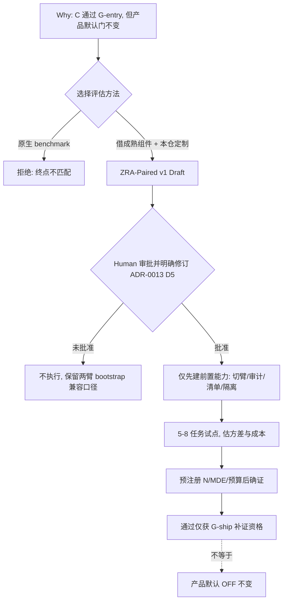

# ZRA-Paired v1 真机 A/B 评估方案（Draft）

> **状态：Draft / 单一收敛方案 / 非规范性文件**
>
> 日期：2026-11-06
>
> 位置：`research/agent-eval-methodology/`
>
> 性质：本文是后续 `ZJ-0015` 的**输入草案**，不是 ADR，不进入 `docs/decisions/`，不登记 `docs/README.md`，不改变任何 Accepted 门。
>
> **执行状态：未开始。** 未创建 ZJ-0015、未实现运行时切臂、未标注任务集、未跑试点、未解除 1-4 阻塞、未做 commit/push。
>
> 原始证据文件全部保留，不删除、不重写 sealed ledger，不覆盖已发布报告。

---

## 0. 一页结论

| 项目 | 收敛后的 Draft 结论 |
|---|---|
| 评估对象 | **B：检索工具对 Agent 任务表现的影响**，具体为检索实现是否减少经审计的恢复性 Read/Grep；不是重做离线 Hit@5，也不是直接评价最终代码补丁质量 |
| 方法选型 | 采用本仓定制的 **ZRA-Paired v1**；不原生复用 SWE-bench、tau-bench、AgentBench、ToolBench 或 T-Eval |
| 可迁移组件 | 借 tau-bench 的多 trial / 固定变量思想、tool-ablation 的检索对照、IR 文献的配对推断、SWE-rebench 的固定脚手架与时间戳污染控制 |
| 主终点 | `d_i = mean(A_i) - mean(C_i)`，其中 A/C 是同一任务在各有效 trial 的恢复性 Read/Grep 次数；正值有利于 C |
| 推断单元 | **任务**是独立簇；trial 只刻画运行方差，不得当独立 N |
| 主检验 | 任务级差值的双侧配对随机化；任务簇 bootstrap 只给 95% 区间 |
| 对照臂 | A baseline、C symbol-union、S 排序破坏对照；S 仅诊断排序价值，不证明完整因果中介 |
| 样本量 | 5–8 任务 × 4 trial × 3 臂只作试点；正式 N、MDE、预算待试点与预注册，`40×4` 不是已论证规模 |
| 当前门状态 | C 仅通过 ADR-0014 的 G-entry；G-ship 的 90%/95% 门不变；1-4 仍 pending+blocked；v3 永久冻结；产品默认 OFF |
| 必须先决策 | 是否新建 `ZJ-0015` 明确修订 ADR-0013 D5 的“两臂 + paired bootstrap 区间”口径；未获 Human 批准前不得执行本方案 |

**核心判断**：调研已完成到“可提交 Human 审批的协议草案”，但尚未完成协议批准，更没有产生真机有效性证据。正式报告 receipt 的 `healthy=true` 只说明报告结构与引用链合格，不说明 C 已在真机中胜出。

---

## 1. 资料收敛、优先级与保留状态

本文按以下优先级消解冲突：Accepted ADR / 正式契约 > 正式研究报告 v2 > 论文原始证据 > sealed GitHub ledger > technical brief > 早期草案 > roadmap 过程记录。

| 层级 | 资产 | 在本文中的作用 | 状态 |
|---|---|---|---|
| 规范约束 | [ADR-0013](../../docs/decisions/ZJ-0013-bounded-reranking-and-independent-agent-value-gate.md) D1/D3/D5/D6 | 不倒推降门、冻结留出集纪律、配对 Agent 验证、停止条件 | Accepted，仍有效；D4 门结构已被 ADR-0014 修订 |
| 规范约束 | [ADR-0014](../../docs/decisions/ZJ-0014-split-retrieval-gate-into-agent-entry-and-ship.md) | G-entry / G-ship 拆门；C 仅获真机评估资格；v3 永久冻结 | Accepted，仍有效 |
| 规范约束 | [Agent Sufficiency v1](../../docs/contracts/baseline-agent-sufficiency-v1.md) | 区分恢复性 Read/Grep 与合法深入、编辑准备、验证读取；正确性不得回退 | Active |
| 研究结论 | [正式报告 v2](2026-11-05-methodology-report-v2.md) 与 [receipt v2](2026-11-05-receipt-v2.json) | **现行方法论结论来源**；reportHash `c30009c917220561547492136a26618c8cf6b1496bbbad8569dddeed4f476959` | 质量门 9/9、`healthy=true`；保留 8 个信息缺口 |
| 编译来源 | [report-ir.json](report-ir.json) | 12 concepts、5 candidates、12 claims、6 comparisons、7 recommendations、7 metrics、7 risks、3 graduationCriteria | 现行 Report IR；本地链接已校正 |
| 论文证据 | [cited-findings.json](cited-findings.json) | P-TAU / P-IR-2009 / P-SWE-REBENCH / P-AGENT-RETRIEVAL / P-ADAPTIVE 的原始证据与本仓适配说明 | 承担统计、重复试验、污染控制方法依据 |
| sealed 证据 | [ledger-response.json](ledger-response.json) | 仅证明 5 个候选 harness 的范围与 unknown；5 candidates、17 evidence、8 unknown、topicMatch 全为 0 | **不**承担核心统计方法证明；原文件不改写 |
| 决策框架 | [technical-decision-brief.json](technical-decision-brief.json) | user / baseline / goals / nonGoals / constraints / stage=`usefulness-validation` | 现行决策框架 |
| 历史材料 | [早期决策备忘录](2026-11-05-methodology-decision.md) 与 [v1 报告](2026-11-05-methodology-report.md) | 保留推理轨迹与发布审计 | **已被正式报告取代**；v1 本地链接为修订前口径 |
| 当前实现 | [itrun.sh](../../scripts/agent-eval/itrun.sh)、[parse-arms.mjs](../../scripts/agent-eval/parse-arms.mjs)、[symbol-index-core.mjs](../../scripts/measure/symbol-index-core.mjs) | 交互式 TUI 执行面、raw Read/Grep 计数、C 候选构造 | 仅证明现状；C 尚未接入运行时，parser 不是审计终点 |
| 过程记录 | [roadmap JSON](../../docs/plans/semantic-retrieval-roadmap.json) 与 [渲染视图](../../docs/plans/SEMANTIC-RETRIEVAL-ROADMAP.md) | 1-7 归档、拆门审批、方法论选型和正式报告发布结论 | 过程 SoT；不是规范 ADR |

### 已被正式报告修订、不得继续沿用的早期口径

1. 早期草案把 `task×repetition` 当作配对推断单元，并以 paired bootstrap 为主检验；现行口径改为**任务级簇**：先对任务内各臂求均值，再对 N 个任务差值做符号翻转随机化，bootstrap 仅给区间。
2. 早期草案用 ABBA 描述臂序；三臂 A/C/S 不能沿用 ABBA。确证优先 `k=6` 覆盖全部 6 种顺序，`k=4` 只能使用预声明的平衡子集。
3. 早期草案把 S 描述为“故意打乱/无关检索结果”；现行 S 必须保持**同候选、同内容、同条数、同 payload schema**，只以固定种子破坏排序，否则会混入信息量差异。
4. 早期草案把 `≥40 任务 × k=4` 写成初判规模；现行方案只承诺先做 5–8 任务试点，正式 N 由任务级差值方差、双侧 α=0.05、80% 功效和实用 MDE 预注册计算。
5. 早期草案建议直接写 ZJ-0015；现行方案先要求 Human 明确是否批准“修订 ADR-0013 D5”。这不是文档顺序问题，而是已 Accepted 规范不能被新报告静默改写。

---

## 2. Know Why — 决策问题与约束

### 2.1 为什么需要这份方案

1-7 在 v3 frozen holdout 上完成三子方向评估，全部 NO-GO，但 C（symbol-union）为历史最佳：baseline macro Hit@5=0.167，C=0.458，提升 +0.292；rails 0.25→0.50，kubernetes 0.083→0.417；MRR 0.154→0.299。宏观放宽门全 PASS，刚性 per-corpus Hit@5≥90% / Hit@10≥95% 全 FAIL。

ADR-0014 将原先兼任“真机 A/B 资源阀门”和“产品默认质量门”的 per-corpus 90% 门拆开：

- **G-entry**：复用 ADR-0013 D4 已有的宏观净增益与回退限制，并补充每仓 Hit@5 净提升 >2pp、无仓回退 >2pp；C 通过，获准进入配对真机评估。
- **G-ship**：每仓 90%/95%、精确名零 Hit@1 回退、延迟/存储/大仓/降级全安全门，**绝对值不变**。

因此当前待解决的是：如何以严谨、可复现、单变量的方式测量 C 对 Agent 的真实价值，而不是再次争论离线 Hit@5，也不是直接解锁产品默认。

### 2.2 目标

- 估计 C 相对当前 `plan()` 在同一任务上减少的**经审计恢复性 Read/Grep**。
- 控制 Agent 随机性、检索动作与检索内容的混淆、任务污染、执行顺序和缺失运行。
- 在正确性不回退的前提下给出继续 / 修订 / 停止结论。
- 为后续是否建立 `ZJ-0015` 提供一份可审阅的协议全文。

### 2.3 非目标

- 不重做 v3 离线 Hit@5/MRR，不复用 v3 做验收或调参。
- 不把最终补丁质量或通用 Agent 任务完成率作为主终点。
- 不建立通用 Agent benchmark，不证明“检索总是有益”。
- 不改变 G-ship 阈值、产品默认行为、1-4 阻塞状态。
- 不声称 shuffled-control 能完整识别“反思 vs 内容”的因果中介。
- 不声称闭源模型训练零污染。
- 不在本轮实现 `ZCG_RETRIEVAL_ARM`、标注任务集或运行试点。

---

## 3. 方法选型：复用、借组件还是本仓定制

| 方案 | 证据与约束 | 判定 |
|---|---|---|
| 原生复用 SWE-bench | sealed 证据显示其 harness 聚焦 patch grading；终点是软件修复结果，不是恢复性 Read/Grep | 拒绝：终点与交互执行面不匹配 |
| 原生复用 tau-bench | 论文提供 `pass^k`、多次 trial 和固定任务语义；终态 reward 不测本仓主终点 | 只借组件，不搬运任务终点 |
| 原生复用 AgentBench / ToolBench / T-Eval | 通用 Agent 环境或工具能力评测；sealed 证据对 paired-design、significance、contamination 多处 unknown | 拒绝原生采用；unknown 不等于 absent |
| 沿用 ADR-0013 D5 原口径 | 两臂、配对 bootstrap 区间、区间跨 0 判 inconclusive；与已 Accepted 规范完全兼容 | 保留为**未批准新 ADR 时的兼容回退方案** |
| 本仓定制 ZRA-Paired v1 | 单变量检索实现消融 + 多 trial + 任务级配对推断 + 排序破坏诊断 + 独立任务集 | **推荐 Draft**；须先获 Human 明确批准修订 D5 |

sealed ledger 的 5 个候选 `topicMatch` 全为 0，存在 8 个 unknownCriteria；其 17 条 GitHub 摘录大多为 Docker、API key、README 或训练命令，不能支撑 Smucker 随机化检验、tau-bench `pass^k`、SWE-rebench 污染控制等核心方法事实。三层证据必须分开：**论文原始证据**承担方法学主张，**sealed ledger**承担候选 harness 范围与 unknown，**本仓文件**承担当前实现与门约束。

---

## 4. Do What — ZRA-Paired v1 协议草案

### 4.1 三臂与唯一变量

| 臂 | 内容 | 角色 |
|---|---|---|
| A | 当前 `plan()` baseline | 主对比参照 |
| C | `symbol-union`，复用 1-7-1 候选构造 | 被测检索实现 |
| S | 与 C 同候选集合、同内容、同条数、同 payload schema，仅以固定种子置换排序 | 排序价值诊断；不是完整因果中介检验 |

A/C/S 必须共享任务、模型版本、prompt、工具 schema、索引快照、MCP 工具面和返回结构。若 `ZCG_RETRIEVAL_ARM` 或 S 序列化改变了工具面，则该运行不满足单变量条件，应剔除并记录原因。

### 4.2 终点、审计与正确性门

- 主终点：`d_i = mean(A_i recovery Read/Grep) - mean(C_i recovery Read/Grep)`，对任务等权；同时报告逐任务差值分布。
- 恢复性 Read/Grep 必须由对 arm 盲化的审计者区分：
  - 恢复性 fallback；
  - 合理深入阅读；
  - 编辑准备读取；
  - 验证读取。
- `parse-arms.mjs` 只给 raw Read/Grep/Glob 计数，不能直接作为主终点。
- 答案充分性规则须在任务解盲前预注册；任何 C 正确性回退触发停止。
- 工具调用数、token、延迟、raw Read/Grep、fallback-free 比例只作诊断或次要检验。

### 4.3 配对、顺序与缺失

- 配对单元为 `task × trial`，但**独立推断单元是任务**。
- 每任务每臂 `k≥4` 有效 trial；确证优先 `k=6`，以覆盖 A/C/S 的 6 种排列；若成本约束使用 `k=4`，必须预声明平衡子集并披露未覆盖顺序。
- 若任一臂缺失运行，默认整任务剔除并报告原因；另做保留可用 `task×trial` 整对的敏感性分析。禁止只删除失败臂。
- 所有失败、超时、inconclusive 和成本都保留在运行清单中。

### 4.4 统计口径

| 层次 | 方法 | 约束 |
|---|---|---|
| 主检验 | 任务级 A−C 差值的双侧符号翻转随机化 | `N≤20` 精确枚举 `2^N`；否则固定 seed 至少 100000 次模拟；α=0.05 双侧 |
| 主区间 | 10000 次任务簇 bootstrap | 重采整个 task，不得独立重采 trial 行；小样本下仅作区间辅助 |
| 次要检验 | C−S、fallback-free 二值结局 McNemar | 预注册 secondary family，Holm 校正；不替代主对比 |
| 一致性诊断 | 借鉴 `pass^k` 的“k 次全部成功”思想 | 缺失不默认成功；不是 `pass@k` best-case |
| 效应量 | `mean(d_i)`、逐任务分布、区间、run-to-run noise | 与 p 值同时报告；显著但小于 MDE 不发布 |

选择随机化为主检验的依据是 IR 统计文献在小 topic 样本下发现 bootstrap p 值存在向下偏差；这不是 tau-bench 的原生统计方案，而是本仓设计推断。

### 4.5 试点、样本量与预注册

- 试点规模：**5–8 任务 × 4 trial × 3 臂**。只允许测量方差、审计一致性、顺序效应、缺失和成本，不做确证显著性结论。
- 确证前冻结：MDE、双侧 α=0.05、power=0.80、k、N、订单方案、primary/secondary family、排除规则、缺失策略、正确性与非劣界限、预算。
- 拟议 MDE 为每任务平均减少 1.5 次恢复性 Read/Grep；这是**待审批设计参数，不是观察值**。
- 以 `N=ceil(2*(1.96+0.84)^2*s_d^2/MDE^2)` 作起点，再用试点分布模拟配对随机化功效。未标定前不承诺 N 或总成本。
- 禁止在看到试点结果后调 MDE/N 以求显著，禁止 inconclusive 后追加批次。

### 4.6 执行前置条件（仅列出，未开始）

1. 实现默认 OFF 的 `ZCG_RETRIEVAL_ARM`，确保 C 与 A 的工具 schema、prompt、模型、索引完全一致。
2. 实现 S 的同 payload 固定种子排序置换，并做配置指纹断言。
3. 建立 arm-blinded fallback 审计、双审与仲裁记录；试点原始一致率目标 ≥90%，未达则修分类协议。
4. 建立不可变运行清单：`task/repo/commit/model/prompt/tool-schema/index/arm/order/trial/permutation-seed/结果/成本/失败原因`。
5. 沿用 [itrun.sh](../../scripts/agent-eval/itrun.sh) 的交互式 Claude Code TUI，不换 headless print-mode。
6. 现有 `--dangerously-skip-permissions` 不得扩展到宿主工作区；实验须用无凭据、一次性只读仓库快照，禁止写入、联网找答案或访问凭据。
7. 固定 seed 的统计单元测试覆盖零效应、人工差值、乱序与缺失运行。

### 4.7 新鲜度与泛化

- 真机任务集独立于 v3 24 题，记录仓、commit、prompt、答案规则、标注人、审阅人、标注时间、是否参与调参。
- 优先使用模型知识截止后的材料；独立标注降低选择泄漏，但不能证明训练零污染。
- 仓级分段只作诊断，避免以少量大仓任务泛化所有 Agent。
- 若未来进入 G-ship 补证，须另建代表性冻结留出集，v3 不复用。

---

## 5. Trade-off 与替代方案

| 决策点 | 选择 | 收益 | 代价 / 约束 |
|---|---|---|---|
| 随机化主检验 vs ADR-0013 D5 的 bootstrap 区间 | 推荐随机化主检验 + 任务簇区间 | 更贴合小任务簇，避免 bootstrap p 值偏宽 | **必须新 ADR 明确修订 D5**；否则保持原两臂口径 |
| 三臂 A/C/S vs 两臂 A/C | 推荐三臂 | S 可诊断“排序价值”与检索动作效应 | 成本 ×1.5；S 仍不能完整识别反思机制 |
| 任务级簇 vs trial 独立 | 任务级簇 | 避免伪重复和 N 虚高 | 功效降低，需先试点估方差 |
| 交互式 TUI vs headless | 交互式 TUI | 接近真实用户体验 | 昂贵、难复现，`skip-permissions` 需隔离 |
| 先试点再定 N vs 直接定 40×4 | 先试点 | 预算与 MDE 有实测依据 | 延后确证；不得中途按结果改参数 |
| 定制协议 vs 原生 benchmark | 定制 | 主终点与单变量完全贴合本仓 | 外部可比性弱，方法所有权与维护成本归本仓 |

若 Human 不批准修订 ADR-0013 D5，兼容回退是：仅 A/C 两臂、配对 bootstrap 区间跨 0 判 inconclusive、不引入 S、不改用随机化主检验。该回退不需要本文的三臂/统计修订，但会失去排序诊断。

---

## 6. Who — 责任边界

| 角色 | 职责 | 当前状态 |
|---|---|---|
| Human / 维护者 | 批准或否决本 Draft；决定是否新建 ZJ-0015；冻结预算、MDE、停止规则；指定负责人 | 待审批 |
| 独立任务集负责人与审阅者 | 新任务标注、来源/时间戳记录、无排名审阅、披露调参历史 | 未指定、未开始 |
| 运行 harness 实现者 | `ZCG_RETRIEVAL_ARM`、S 序列化、配置指纹、manifest、隔离快照 | 未开始 |
| fallback 审计负责人 | 分类协议、盲审、双审、仲裁、一致性报告 | 未开始 |
| 评估设计者 / 统计实现者 | 预注册、随机化、bootstrap、Holm、功效模拟、固定 seed 测试 | 未开始 |
| 本仓 | 拥有任务语义、终点、审计、停止判定与全部适配代码 | ownership 明确 |
| 外部论文 / benchmark | 仅提供方法组件和证据，不拥有本仓结论 | 不转移所有权 |

---

## 7. How — 验证、毕业与停止规则

### 7.1 正式任务解盲前的五项进入条件

1. 三臂工具 schema / payload 字节结构一致，且配置指纹显示仅检索实现或排序种子变化。
2. 构造性轨迹能区分 recovery / deepening / edit-prep / verification，双审原始一致率 ≥90%。
3. 乱序、缺失运行、整任务剔除与敏感性分析测试通过。
4. 固定 seed 统计测试覆盖零效应与人工差值。
5. 正确性规则盲审可用，失败与超时保留。

任一项未通过，先修协议或 harness，不得进入确证实验。

### 7.2 确证判定

只有同时满足以下条件，才允许 C 获得**另行 G-ship 补证资格**：

- 双侧任务级随机化 `p<0.05`；
- `mean(A−C) ≥` 预注册 MDE；
- 任务簇 95% 区间不跨 0；
- 审计一致性与运行清单通过；
- 正确性无可接受性回退。

该结果**不等于**进入产品默认，也不等于 1-4 解锁；G-ship 仍需新冻结代表性留出集上的 90%/95% 与全部安全门。

### 7.3 停止与 inconclusive

- 任一正确性回退：停止本轮产品化。
- 区间跨 0、预算不足或效应量未达 MDE：`inconclusive`，不追加批次求显著。
- S 改善接近 C：标记排序价值存疑，不得自动宣称“反思是原因”。
- 试点方差使所需 N 超预算：停止或重新提交更小的 MDE/预算决策，不得静默扩大实验。

### 7.4 生命周期

当前阶段为 `usefulness-validation`。本 Draft 不进入 `dogfood` 或 `release`；没有产品开关、回滚、监控、升级/降级或版本漂移问题，因为尚无产品行为变更。

---

## 8. 风险登记与信息缺口

| 风险 | 触发 | 影响 | 缓解 | 残余风险 | 负责人 |
|---|---|---|---|---|---|
| 任务数不足或方差大 | 试点 `s_d²` 使所需 N 超预算 | 区间过宽，不能决策 | 解盲前按任务级方差模拟功效并预注册预算上限 | 试点可能低估正式任务异质性 | 评估设计者与维护者 |
| fallback 分类主观 | 双审一致率 <90% 或系统性偏向 | 主效应反映审计噪声 | 构造性样例、隐藏 arm 双审、仲裁记录、未达则停 | 仲裁仍有解释差异 | 审计负责人 |
| S 识别力有限 | S 与 C 都减少 fallback，或置换改变工具可信度 | 无法唯一归因排序或反思 | 限定为诊断，保持内容不变并披露边界 | 主实验只稳健估计整臂效果 | 评估设计者 |
| 任务污染 / 选择泄漏 | 与 v3 重叠、标注者参与调参、任务早于知识截止 | 泛化结论失效 | 独立任务集、时间戳、来源与审阅独立性、显式披露 | 无法审计闭源模型训练集 | 任务集负责人与独立审阅者 |
| 切臂或执行环境污染 | A/C/S 的 schema、prompt、payload、索引、模型或顺序失衡 | 差值不能归因检索实现 | 配置指纹、任务内平衡臂序、版本清单、拒绝不合格运行 | 宿主服务漂移仍可能贡献噪声 | harness 实现者 |
| `skip-permissions` / 模型命令越界 | 写入、联网、读取凭据或离开快照 | 损坏工作区 / 泄露信息 / 污染实验 | 无凭据一次性只读快照、隔离账户、禁止写入与网络、逐 run 审查 | 交互式 Agent 可能有未预见逃逸路径 | 执行者与维护者 |
| 成本超支 | 试点每任务三臂成本 × 正式 N 超上限 | 功效不足或中途停止 | 汇总成功与失败成本，确证前设硬预算；不足时停止或重选 MDE | 价格、速度、失败率可能变化 | 维护者与执行者 |

### 8.1 明确保留的 8 个 unknownCriteria

sealed ledger 对以下组合没有充分证据：tau-bench / statistical-significance、tau-bench / contamination-control、AgentBench / statistical-significance、AgentBench / endpoint-metrics、T-Eval / paired-design、T-Eval / statistical-significance、T-Eval / endpoint-metrics、T-Eval / contamination-control。

此外仍未验证或未决：正式 N、总成本、MDE 是否被接受、审计一致性、C/S 运行时接线、S 的识别力、独立任务集、闭源模型污染、试点方差与 run-to-run noise。信息状态保持 `has-gaps`。

---

## 9. Human 审批项（全部未决）

- [ ] 是否接受 **ZRA-Paired v1** 作为待审批协议，而非原生复用 benchmark？
- [ ] 是否批准新建 `ZJ-0015`，明确修订 ADR-0013 D5 为“三臂 + 任务级随机化主检验 + 任务簇区间”？若不批准，是否退回两臂 paired-bootstrap 兼容口径？
- [ ] 是否接受 S 仅作排序破坏诊断，并接受它不能完整证明反思机制？
- [ ] 是否接受 `5–8×4×3` 试点仅用于方差、审计与成本标定？
- [ ] 谁负责任务集独立标注、盲审、harness 实现、统计预注册与预算审批？
- [ ] 是否在以上问题全部明确后才允许开始实现与试点？

**在这些问题得到明确答复前，不开始执行工作。**

---

## 10. 本轮明确没有做的事

- 没有创建 `docs/decisions/ZJ-0015*`，没有把本文标为 Accepted ADR。
- 没有修改 `docs/README.md`、Accepted ADR、contract、method 或正式 roadmap 规则。
- 没有实现 `ZCG_RETRIEVAL_ARM`、S 序列化、审计器、统计代码或隔离 harness。
- 没有标注独立任务集，没有运行任何 agent trial 或试点。
- 没有解除 1-4 的 `blocks` 边，没有改变产品默认 OFF，没有复用 v3 holdout。
- 没有删除或覆盖任何既有调研文件，没有改写 sealed ledger，没有覆盖已发布报告。
- 没有执行 commit/push。

---

## 11. 来源清单

### 11.1 本仓与本研究目录

- [正式报告 v2](2026-11-05-methodology-report-v2.md) · [HTML](2026-11-05-methodology-report-v2.html) · [receipt v2](2026-11-05-receipt-v2.json)
- [Report IR](report-ir.json) · [cited findings](cited-findings.json) · [technical decision brief](technical-decision-brief.json)
- [sealed ledger](ledger-response.json) · [collect request](collect-request.json) · [collection status](collection-status.json)
- [早期草案备忘录](2026-11-05-methodology-decision.md) · [v1 报告（仅审计留档）](2026-11-05-methodology-report.md)
- [ADR-0013](../../docs/decisions/ZJ-0013-bounded-reranking-and-independent-agent-value-gate.md) · [ADR-0014](../../docs/decisions/ZJ-0014-split-retrieval-gate-into-agent-entry-and-ship.md)
- [Agent Sufficiency v1](../../docs/contracts/baseline-agent-sufficiency-v1.md)
- [itrun.sh](../../scripts/agent-eval/itrun.sh) · [parse-arms.mjs](../../scripts/agent-eval/parse-arms.mjs) · [symbol-index-core.mjs](../../scripts/measure/symbol-index-core.mjs)
- [semantic retrieval roadmap JSON](../../docs/plans/semantic-retrieval-roadmap.json) · [渲染视图](../../docs/plans/SEMANTIC-RETRIEVAL-ROADMAP.md)

### 11.2 论文原始证据 ID

| ID | 来源 | 承担的主张 |
|---|---|---|
| P-TAU | [tau-bench, arXiv:2406.12045v1](https://arxiv.org/html/2406.12045v1) | `pass^k`、多次独立 trial、固定任务语义；终态 reward 的局限 |
| P-IR-2009 | [Agreement among statistical significance tests, ACM DOI 10.1145/1571941.1572050](https://dl.acm.org/doi/abs/10.1145/1571941.1572050) | 小 topic 样本下 bootstrap 偏差与 randomization test 建议 |
| P-SWE-REBENCH | [SWE-rebench, arXiv:2505.20411v2](https://arxiv.org/html/2505.20411v2) | 固定 scaffold、五次完整运行、SEM、时间戳污染标记；不承诺零污染 |
| P-AGENT-RETRIEVAL | [Coding Agents are Effective Long-Context Processors, arXiv:2603.20432v1](https://arxiv.org/html/2603.20432v1) | 有检索器时原生搜索减少但正确性不总提升；机制仍开放 |
| P-ADAPTIVE | [Adaptive Retrieval helps Reasoning in LLMs, arXiv:2602.07213](https://arxiv.org/abs/2602.07213) | 检索动作与反思混淆的研究动机；不是因果中介证明 |

---

## 12. 收敛结论

本文件把「决策框架 → sealed 采集 → 论文证据 → 正式报告 v2 → ADR 约束 → 当前实现能力 → 风险与停止规则」合并为**一份 Draft 方案**。它推荐 ZRA-Paired v1，但把最难逆转的三处变化——任务级随机化推断、三臂 S 诊断、对 ADR-0013 D5 的明确修订——全部留给 Human 审批。

研究已经收敛；**执行尚未开始，也不应在审批前开始。**
