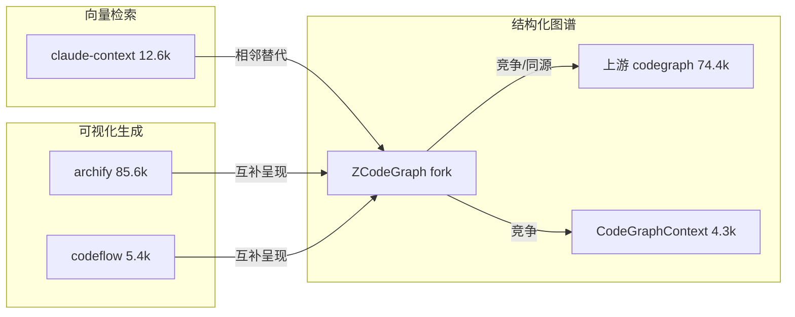
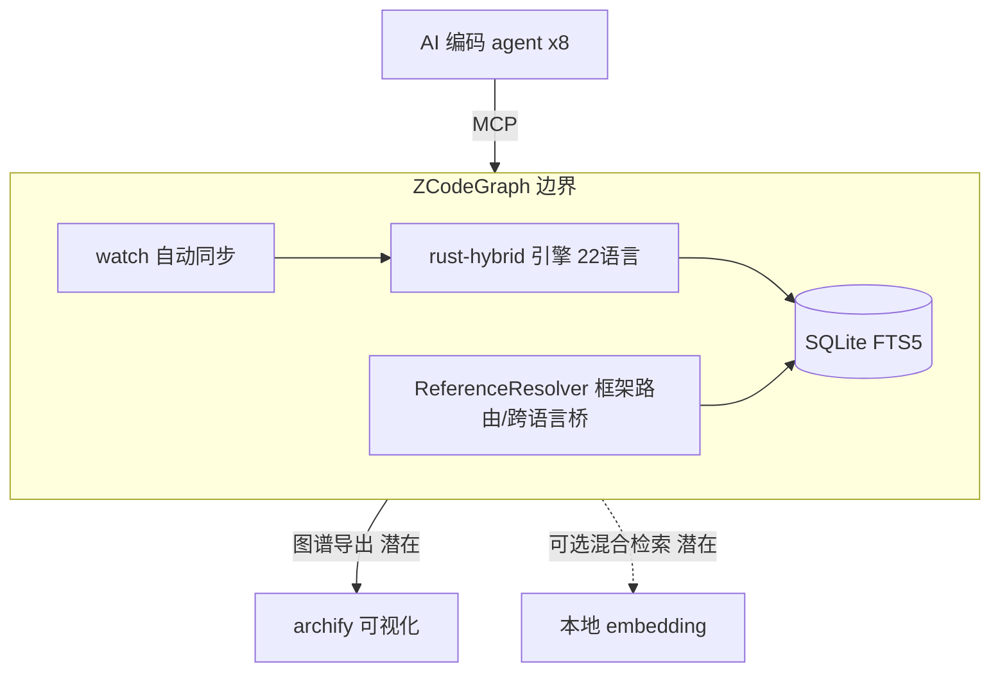

# 调研主题
ZCodeGraph 与同类代码智能项目对比：产品/技术/目标用户

对比 ZCodeGraph（本项目 fork）与上游 codegraph、archify、CodeGraphContext、codeflow、claude-context 六项目在产品优劣势、技术优劣势与目标用户上的差异，给出 ZCodeGraph『本地确定性结构化图谱引擎』的定位建议与分阶段发展方向。

## 输入材料与观察时间
Evidence ledger: `0b46770b2a71879e027ee0e7235d467d0e32fda3ac3b4d3b630aea4c7d96b495`
Observed: 2026-10-19T09:37:06.792Z

## Key-Value 概念索引
- Key: `decision-frame` — problem-discovery 阶段的产品定位决策：在三条技术路线（结构化图谱/向量检索/可视化）并存的格局下，确定 ZCodeGraph 的差异化定位与发展方向。
- Key: `fit-model` — 按 constraint→option→evidence→tradeoff→decision 评估六候选在本地性、确定性、性能、语义能力、可视化、分发六维的适配度。
- Key: `ownership-model` — ZCodeGraph 为个人维护 fork，需自行承担 rebase 上游、性能基准、分发与品牌建设的全部所有权成本。
- Key: `lifecycle-stage` — problem-discovery：输出方向性建议与 discovery 退出条件，不做 dogfood/release 级生产承诺。
- Key: `route-structured-graph` — 结构化图谱路线（ZCodeGraph/上游/CodeGraphContext）：tree-sitter 抽取符号与边，回答 callers/callees/impact 等结构问题。
- Key: `route-vector` — 向量检索路线（claude-context）：AST 分块 + embedding + 向量库，按语义召回相关代码块。
- Key: `route-visual` — 可视化生成路线（archify/codeflow）：把代码库/描述编译为可分享架构图，属呈现层而非查询层。

Concepts: [[decision-frame]], [[fit-model]], [[ownership-model]], [[lifecycle-stage]], [[route-structured-graph]], [[route-vector]], [[route-visual]]

## C4 System Landscape
### 代码智能赛道格局

## 候选项目表
| Repository | Stars | Topic match |
|---|---:|---:|
| jununfly/ZCodeGraph | 2 | 3 |
| colbymchenry/codegraph | 74416 | 17 |
| tt-a1i/archify | 85602 | 14 |
| CodeGraphContext/CodeGraphContext | 4297 | 11 |
| braedonsaunders/codeflow | 5421 | 6 |
| zilliztech/claude-context | 12624 | 19 |

## 深读项目卡片
### ZCodeGraph（本项目）
角色：本地优先结构化代码知识图谱 fork。最强能力：rust-hybrid 确定性抽取 + 22 语言 + 14 框架路由 + 跨语言桥接 + 自动同步。主要差距：stars=2，几乎无社区采用与品牌认知，分发依赖个人 npm 账号。证据强度：native（架构/功能有 ledger 与仓库 README 双重佐证）。

- Claim `cl-zg-arch`
- Claim `cl-zg-rust`
- Claim `cl-zg-users`
- Claim `cl-zg-stars`
- Claim `cl-zg-differentiator`

### colbymchenry/codegraph（上游）
角色：赛道头部结构化代码图谱原项目。最强能力：74.4k stars 的生态认知、成熟文档治理与浏览器 viewer。主要差距：相对 fork 缺少 rust-hybrid 引擎与部分框架/跨语言增强（fork 的差异化点）。证据强度：native。

- Claim `cl-up-parity`
- Claim `cl-up-stars`
- Claim `cl-up-users`

### tt-a1i/archify
角色：架构图可视化 agent skill（生成侧）。最强能力：85.6k stars、可验证 JSON IR→确定性 HTML 编译链 + 快照对比，把一次性聊天答案变成可复查产物。主要差距：非索引/查询工具，不提供 callers/impact 等结构化图查询，与 ZCodeGraph 互补而非直接竞争。证据强度：native（产品定位）+ unknown（ledger 未覆盖其 technical-architecture/differentiation 两条 criteria）。

- Claim `cl-ar-product`
- Claim `cl-ar-stars`
- Claim `cl-ar-users`

### CodeGraphContext
角色：图数据库路线 MCP+CLI（Python）。最强能力：Neo4j/FalkorDB 真实图查询、死代码/复杂度分析、最广 agent 配置向导、新增 HTTP Gateway。主要差距：需外部图数据库进程（Windows 上 FalkorDB Lite 不可用），部署与零配置本地性弱于 SQLite 内嵌方案。证据强度：native。

- Claim `cl-cgc-product`
- Claim `cl-cgc-tech`
- Claim `cl-cgc-diff`
- Claim `cl-cgc-users`

### braedonsaunders/codeflow
角色：浏览器端可视化/体检工具（零安装）。最强能力：零门槛 paste-URL 出图 + PR 影响 + 安全扫描 + 健康分 + churn 热图 + README SVG Card。主要差距：非 MCP、无持久化增量索引与 agent 内联查询，定位为一次性可视化而非 agent 工作流基础设施。证据强度：native（技术/差异化）+ unknown（ledger 未覆盖其 product-positioning criterion）。

- Claim `cl-cf-product`
- Claim `cl-cf-diff`

### zilliztech/claude-context
角色：向量检索路线 MCP（语义搜索）。最强能力：AST 分块 + 混合检索（BM25+embedding）、嵌入/向量库可插拔、Milvus 团队背书、12.6k stars、13+ 客户端。主要差距：语义相似召回无法理解调用关系/影响半径，且依赖外部向量库与 embedding API key。证据强度：native。

- Claim `cl-cc-product`
- Claim `cl-cc-tech`
- Claim `cl-cc-stars`

## 方案族及适用场景对比
### cp-role-family
六项目分属三条技术路线：结构化图谱查询（ZCodeGraph/上游/CodeGraphContext，回答 callers/impact 等结构问题）、语义向量检索（claude-context，回答『找相关代码』）、可视化生成（archify/codeflow，产出可分享架构图）。ZCodeGraph 与上游、CodeGraphContext 在同一子赛道直接竞争；archify/codeflow 是互补的下游呈现层；claude-context 是相邻替代方案。

Claims: `cl-zg-arch`, `cl-up-parity`, `cl-ar-product`, `cl-cgc-product`, `cl-cf-product`, `cl-cc-product`

### cp-product-adv
产品维度：ZCodeGraph 优势在 rust-hybrid 性能、框架路由识别与跨语言桥接（真实仓库的 URL→handler、Swift↔ObjC 等 grep 无法覆盖的流动），以及 watch 自动同步；劣势在 stars=2 的分发与品牌，远逊于上游 74.4k 与 archify 85.6k。CodeGraphContext 以死代码/复杂度分析与最广 agent 向导取胜；codeflow 以零安装与 PR 影响/安全体检取胜。

Claims: `cl-zg-rust`, `cl-zg-differentiator`, `cl-up-stars`, `cl-cgc-diff`, `cl-cf-diff`

### cp-tech-adv
技术维度：ZCodeGraph 的 SQLite(FTS5) 内嵌 + tree-sitter 确定性抽取做到真零配置、100% 本地、无外部进程，rust-hybrid 进一步降索引时延；对比 CodeGraphContext 需 Neo4j/FalkorDB 外部图库（Windows 需 WSL/Docker）、claude-context 需 Milvus 向量库 + embedding API key，ZCodeGraph 本地性最强。劣势：无向量语义召回能力（对『按意思找代码』类查询弱于 claude-context），无可视化 viewer（上游有 dist/viewer，codeflow/archify 专精于此）。

Claims: `cl-zg-arch`, `cl-zg-rust`, `cl-cgc-tech`, `cl-cc-tech`, `cl-cf-product`

### cp-users
目标用户：ZCodeGraph 与上游同瞄准『使用 MCP 编码 agent、在中大型仓库做结构化探索/改动前影响分析』的开发者；CodeGraphContext 面向愿自管图数据库、需要死代码/复杂度治理的团队与最广 agent 用户；claude-context 面向受上下文窗口/成本约束、需语义搜索的大仓库团队；archify/codeflow 面向需要架构文档/评审/分享产物的开发者（含非 MCP 用户），门槛最低、受众最广。

Claims: `cl-zg-users`, `cl-up-users`, `cl-ar-users`, `cl-cgc-users`, `cl-cf-product`, `cl-cc-product`

### cp-positioning
定位结论：ZCodeGraph 不应与上游拼『通用代码图谱』认知（stars 差距 3.7 万倍难以逆转），也不应转向向量检索（claude-context 已有 Milvus 背书与主题相关度优势）。可行定位是『结构化图谱中最强的本地确定性引擎』——以 rust-hybrid 性能、框架路由、跨语言桥接建立可验证的技术纵深，并视 archify 类可视化 skill 为天然互补的呈现出口而非对手。

Claims: `cl-zg-differentiator`, `cl-up-parity`, `cl-cc-product`, `cl-ar-product`

### cp-evidence-gaps
证据缺口：sealed ledger 对 archify 的 technical-architecture/differentiation、codeflow 的 product-positioning 三条 criteria 未返回证据（unknownCriteria），本报告对这三点仅依据其官方 README 的二手描述标记为 unknown，不作为强弱评分依据；未对任何候选做性能实测，速度/内存结论以各自声明为准。

Claims: `cl-ar-product`, `cl-cf-product`

## C4 Context/Container 与子主题图
### ZCodeGraph 系统边界与集成缝

## 关键技术指标矩阵
| Metric | Definition | Unit | Method | Condition | Expected |
|---|---|---|---|---|---|
| index-latency-ratio | ZCodeGraph rust-hybrid 与上游在相同语料上的全量索引墙钟时间比 | ratio | 在 ZCodeGraph repo/Excalidraw/VS Code sparse 三语料各跑 3 次取中位 | 发布 P1 基准时 | < 1.0（rust-hybrid 更快） |
| tool-call-reduction | agent 回答结构化问题时 ZCodeGraph 相对 grep/read 基线的工具调用数下降 | % | 确定性 sufficiency 探针 + 一次性 agent A/B smoke | release 快照 | ≥ 50% |
| cross-file-coverage | ≥1 条跨文件非 contains 边的符号文件占比（剔除 barrel/test/generated） | % | real-corpus gate 探针统计 | 每语言迁移完成 | ≥ 65%（参照 actix 65.4 天花板） |
| route-handler-link | 框架 route 节点成功链接到 handler 的比例 | % | real-corpus gate（Express/Spring/Play 等） | 每框架接入 | ≥ 90% |
| adoption-proxy | npm 周下载量与 GitHub stars 作为分发代理指标 | count | npm/GitHub API 月度采集 | 持续 | P1 后建立基线 |
| ownership-cost | 维护 fork 相对上游的 rebase/merge 人力投入 | 人时/月 | 维护者自报 + PR 记录 | 持续 | 可控且不随上游大版本激增 |

## 建议、限制与待验证事项
### rec-overall
总体定位：坚持『本地优先、确定性、结构化代码知识图谱』赛道，把差异化押注在 rust-hybrid 引擎性能、框架路由识别与跨语言桥接上——这是上游与向量检索/可视化类项目都未覆盖的技术纵深，避免在『通用代码图谱』认知战或语义检索赛道上正面竞争。

Comparisons: `cp-role-family`, `cp-positioning`

### rec-constraint-table
约束→选择：① 若目标是社区采用与分发——受 stars=2 约束，短期无法超越上游，应优先做『可被上游用户无痛切换』的兼容与差异化证明，而非另立品牌；② 若目标是技术深度——受 rust-hybrid 已落地约束，应继续扩大 Rust-owned 语言与框架覆盖；③ 若目标是用户价值闭环——受无可视化约束，应与 archify 类呈现层集成而非自研 viewer。

Comparisons: `cp-product-adv`, `cp-tech-adv`

### rec-phased
分阶段落地：P0（保持优势）完成 Rust 迁移 roadmap 剩余语言、夯实自动同步与 doctor 诊断可信度；P1（建立差异）发布与上游的可复现 A/B 基准（索引时延/工具调用数/覆盖天花板），把 rust-hybrid 转化为可量化卖点；P2（拓展受众）提供 ZCodeGraph→archify/通用可视化的导出桥，切入架构文档场景；P3（补能力缺口）评估引入可选的本地 embedding 混合检索，覆盖『按意思找代码』场景。

Comparisons: `cp-positioning`, `cp-tech-adv`

### rec-avoid
应避免的路径：① 不与上游拼通用认知与 star 数；② 不自研重型向量数据库/外部图数据库（破坏零配置本地性这一核心优势）；③ 不把 archify/codeflow 视为竞争对手而复制其可视化，应视为互补出口；④ 不在 problem-discovery 阶段承诺 dogfood/release 级的生产运维承诺。

Comparisons: `cp-role-family`, `cp-positioning`

### rec-risks
遗留风险：上游可能吸收 fork 的 rust-hybrid 差异化（需持续保持迁移领先）；向量检索与结构化图谱长期可能融合（需评估混合架构）；分发依赖个人 npm 账号存在单点风险；archify/codeflow 三条 evidence 缺口意味着对其强弱判断部分基于二手 README，需后续验证。

Comparisons: `cp-evidence-gaps`, `cp-product-adv`

- Unknown: tt-a1i/archify / technical-architecture
- Unknown: tt-a1i/archify / differentiation
- Unknown: braedonsaunders/codeflow / product-positioning

## 来源清单
- [jununfly/ZCodeGraph@50b7270c421f26f6646e99309ea57dbe01bae481:AGENTS.md](https://github.com/jununfly/ZCodeGraph/blob/50b7270c421f26f6646e99309ea57dbe01bae481/AGENTS.md) — Evidence `8eee98fa46270d44556f7d8b`
- [jununfly/ZCodeGraph@50b7270c421f26f6646e99309ea57dbe01bae481:AGENTS.md](https://github.com/jununfly/ZCodeGraph/blob/50b7270c421f26f6646e99309ea57dbe01bae481/AGENTS.md) — Evidence `194e7c883aea334c869115d8`
- [jununfly/ZCodeGraph@50b7270c421f26f6646e99309ea57dbe01bae481:AGENTS.md](https://github.com/jununfly/ZCodeGraph/blob/50b7270c421f26f6646e99309ea57dbe01bae481/AGENTS.md) — Evidence `ed2dd3d73ecf150752f85ccd`
- [jununfly/ZCodeGraph@50b7270c421f26f6646e99309ea57dbe01bae481:AGENTS.md](https://github.com/jununfly/ZCodeGraph/blob/50b7270c421f26f6646e99309ea57dbe01bae481/AGENTS.md) — Evidence `a81610096013c1980a4fd3b8`
- [jununfly/ZCodeGraph@50b7270c421f26f6646e99309ea57dbe01bae481:AGENTS.md](https://github.com/jununfly/ZCodeGraph/blob/50b7270c421f26f6646e99309ea57dbe01bae481/AGENTS.md) — Evidence `e2f9a55215ee872c7411ed3a`
- [colbymchenry/codegraph@a944ec35791f527bf58d953ad564ee50ba870fdd:AGENTS.md](https://github.com/colbymchenry/codegraph/blob/a944ec35791f527bf58d953ad564ee50ba870fdd/AGENTS.md) — Evidence `85598bcd2bba4ff103390a11`
- [colbymchenry/codegraph@a944ec35791f527bf58d953ad564ee50ba870fdd:AGENTS.md](https://github.com/colbymchenry/codegraph/blob/a944ec35791f527bf58d953ad564ee50ba870fdd/AGENTS.md) — Evidence `c6212e37c3665285dd59f3b8`
- [colbymchenry/codegraph@a944ec35791f527bf58d953ad564ee50ba870fdd:AGENTS.md](https://github.com/colbymchenry/codegraph/blob/a944ec35791f527bf58d953ad564ee50ba870fdd/AGENTS.md) — Evidence `e4acf2e6a7e38e8fa91661be`
- [colbymchenry/codegraph@a944ec35791f527bf58d953ad564ee50ba870fdd:AGENTS.md](https://github.com/colbymchenry/codegraph/blob/a944ec35791f527bf58d953ad564ee50ba870fdd/AGENTS.md) — Evidence `a46d193bd8f80810be1a0abc`
- [colbymchenry/codegraph@a944ec35791f527bf58d953ad564ee50ba870fdd:AGENTS.md](https://github.com/colbymchenry/codegraph/blob/a944ec35791f527bf58d953ad564ee50ba870fdd/AGENTS.md) — Evidence `3aa3dfddd0d3354ec67c507b`
- [tt-a1i/archify@654da74e084e5a1faf708779c23d6172766be9c1:.agents/README.md](https://github.com/tt-a1i/archify/blob/654da74e084e5a1faf708779c23d6172766be9c1/.agents/README.md) — Evidence `410aa6496f2c4ebc266b0f5f`
- [tt-a1i/archify@654da74e084e5a1faf708779c23d6172766be9c1:.agents/README.md](https://github.com/tt-a1i/archify/blob/654da74e084e5a1faf708779c23d6172766be9c1/.agents/README.md) — Evidence `7e77bb3efe0583af236d541a`
- [tt-a1i/archify@654da74e084e5a1faf708779c23d6172766be9c1:benchmarks/ordinary-model-floor/README.md](https://github.com/tt-a1i/archify/blob/654da74e084e5a1faf708779c23d6172766be9c1/benchmarks/ordinary-model-floor/README.md) — Evidence `6076454f5f54d74761a95078`
- [CodeGraphContext/CodeGraphContext@1b595a61663d60862ac20aca2422ea187671c01c:docs/INTEGRATION_GUIDE.md](https://github.com/CodeGraphContext/CodeGraphContext/blob/1b595a61663d60862ac20aca2422ea187671c01c/docs/INTEGRATION_GUIDE.md) — Evidence `ac57f801b68b665303c8d991`
- [CodeGraphContext/CodeGraphContext@1b595a61663d60862ac20aca2422ea187671c01c:docs/INTEGRATION_GUIDE.md](https://github.com/CodeGraphContext/CodeGraphContext/blob/1b595a61663d60862ac20aca2422ea187671c01c/docs/INTEGRATION_GUIDE.md) — Evidence `d44565eb45b8ceaa82fd9ba4`
- [CodeGraphContext/CodeGraphContext@1b595a61663d60862ac20aca2422ea187671c01c:docs/MCP_TOOLS.md](https://github.com/CodeGraphContext/CodeGraphContext/blob/1b595a61663d60862ac20aca2422ea187671c01c/docs/MCP_TOOLS.md) — Evidence `7e1ab682624eaaf81620fdf0`
- [CodeGraphContext/CodeGraphContext@1b595a61663d60862ac20aca2422ea187671c01c:docs/MCP_TOOLS.md](https://github.com/CodeGraphContext/CodeGraphContext/blob/1b595a61663d60862ac20aca2422ea187671c01c/docs/MCP_TOOLS.md) — Evidence `6f20f7b5780a944e64281054`
- [CodeGraphContext/CodeGraphContext@1b595a61663d60862ac20aca2422ea187671c01c:docs/docs/contributing_languages.md](https://github.com/CodeGraphContext/CodeGraphContext/blob/1b595a61663d60862ac20aca2422ea187671c01c/docs/docs/contributing_languages.md) — Evidence `95e6a2a2270a88f28ea44cc2`
- [braedonsaunders/codeflow@b0e82d127fc4990f571ebc6da6c5d9af2591aaa1:README.md](https://github.com/braedonsaunders/codeflow/blob/b0e82d127fc4990f571ebc6da6c5d9af2591aaa1/README.md) — Evidence `a576a028503898ec2494665c`
- [braedonsaunders/codeflow@b0e82d127fc4990f571ebc6da6c5d9af2591aaa1:README.md](https://github.com/braedonsaunders/codeflow/blob/b0e82d127fc4990f571ebc6da6c5d9af2591aaa1/README.md) — Evidence `1837bd5ee643c88ed09a7bc4`
- [braedonsaunders/codeflow@b0e82d127fc4990f571ebc6da6c5d9af2591aaa1:README.md](https://github.com/braedonsaunders/codeflow/blob/b0e82d127fc4990f571ebc6da6c5d9af2591aaa1/README.md) — Evidence `85fa724ff00f297ab0e7dcbf`
- [braedonsaunders/codeflow@b0e82d127fc4990f571ebc6da6c5d9af2591aaa1:README.md](https://github.com/braedonsaunders/codeflow/blob/b0e82d127fc4990f571ebc6da6c5d9af2591aaa1/README.md) — Evidence `f2e51da9228513df531d8d86`
- [zilliztech/claude-context@6fc318b4e3ce58e2898b00a9c3538ead9e24dee5:AGENTS.md](https://github.com/zilliztech/claude-context/blob/6fc318b4e3ce58e2898b00a9c3538ead9e24dee5/AGENTS.md) — Evidence `83e1d9ed45034d3bfaed9b71`
- [zilliztech/claude-context@6fc318b4e3ce58e2898b00a9c3538ead9e24dee5:AGENTS.md](https://github.com/zilliztech/claude-context/blob/6fc318b4e3ce58e2898b00a9c3538ead9e24dee5/AGENTS.md) — Evidence `722169e01b707d336cab69bb`
- [zilliztech/claude-context@6fc318b4e3ce58e2898b00a9c3538ead9e24dee5:AGENTS.md](https://github.com/zilliztech/claude-context/blob/6fc318b4e3ce58e2898b00a9c3538ead9e24dee5/AGENTS.md) — Evidence `21bab4630c3f1e0da6f3faaa`
- [zilliztech/claude-context@6fc318b4e3ce58e2898b00a9c3538ead9e24dee5:docs/troubleshooting/troubleshooting-guide.md](https://github.com/zilliztech/claude-context/blob/6fc318b4e3ce58e2898b00a9c3538ead9e24dee5/docs/troubleshooting/troubleshooting-guide.md) — Evidence `ea98f0a334a54a08b068ec22`
- [zilliztech/claude-context@6fc318b4e3ce58e2898b00a9c3538ead9e24dee5:packages/mcp/README.md](https://github.com/zilliztech/claude-context/blob/6fc318b4e3ce58e2898b00a9c3538ead9e24dee5/packages/mcp/README.md) — Evidence `90459dc8b44f9ba24eb2e6de`
