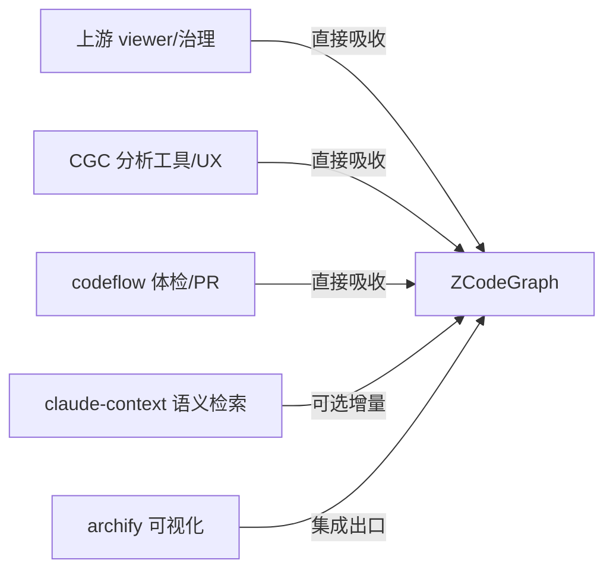
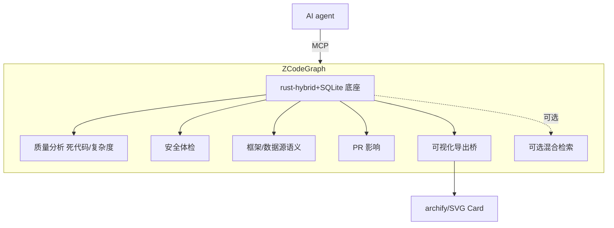

# 调研主题
ZCodeGraph 能力汇集调研：汇集同类项目的有用之处与好用之处

放弃竞争差异化路线，逐候选拆解 5 个同类项目的有用之处（功能价值）与好用之处（UX/工程），以单元能力粒度标注 ZCodeGraph 已有/可适配/缺失/未知，给出按价值/成本排序的分阶段汇集路径：P0 好用性+质量分析，P1 框架/数据语义+PR影响+可视化出口，P2 可选本地混合语义检索。

## 输入材料与观察时间
Evidence ledger: `0b46770b2a71879e027ee0e7235d467d0e32fda3ac3b4d3b630aea4c7d96b495`
Observed: 2026-10-19T09:37:06.792Z

## Key-Value 概念索引
- Key: `decision-frame` — problem-discovery 阶段的能力汇集决策：汇集同类项目有用/好用之处到 ZCodeGraph，先做到足够有用好用，非竞争差异化。
- Key: `harvest-model` — 以单元能力为粒度，按 constraint→option→evidence→tradeoff→decision 评估每项能力的价值与吸收成本，决定直接吸收/集成复用/暂缓。
- Key: `ownership-model` — 汇集的全部能力由 ZCodeGraph 维护者承担实现、测试与持续演进所有权；集成复用能力另承担与上游 rebase 的成本。
- Key: `lifecycle-stage` — problem-discovery：输出汇集清单与路径，不做 dogfood/release 级生产承诺。
- Key: `capability-domains` — 八能力域：结构查询/可视化呈现/质量分析/安全体检/框架与数据语义/PR 与 CI 工作流/语义检索/工程与 UX。
- Key: `harvest-modes` — 汇集三方式：直接吸收（自研为 MCP 工具/SQL 分析）、集成复用（archify/SVG Card 作出口）、可选增量（语义检索，默认关闭）。
- Key: `architecture-invariant` — 汇集底线：保住 SQLite 内嵌、零配置、100% 本地、确定性 AST；新增能力以只读分析/呈现/可选增量为主，不引入强制外部服务。

Concepts: [[decision-frame]], [[harvest-model]], [[ownership-model]], [[lifecycle-stage]], [[capability-domains]], [[harvest-modes]], [[architecture-invariant]]

## C4 System Landscape
### 能力汇集格局：各项目作为能力来源

## 候选项目表
| Repository | Stars | Topic match |
|---|---:|---:|
| jununfly/ZCodeGraph | 2 | 3 |
| colbymchenry/codegraph | 74416 | 17 |
| tt-a1i/archify | 85602 | 14 |
| CodeGraphContext/CodeGraphContext | 4297 | 11 |
| braedonsaunders/codeflow | 5421 | 6 |
| zilliztech/claude-context | 12624 | 19 |

## 深读项目卡片
### ZCodeGraph（汇集落点）
已有：rust-hybrid/22语言/14框架路由/跨语言桥/自动同步/八 MCP 工具。角色：把下列各项目之长汇入此基线。最强资产：SQLite 内嵌零配置 + 确定性 AST。吸收原则：保住该架构，新增能力以只读分析/呈现/可选增量为主。

- Claim `cl-zg-base`
- Claim `cl-zg-strength`

### 上游 codegraph → 吸收 viewer 与工程治理
有用：浏览器 viewer 交互可视化（与索引同 grammar 高亮）。好用：AGENTS.md 分层治理、release 工程化。汇集方式：直接吸收——viewer 与 UI build 校验思路可移植，文档治理可复制。成本：中。

- Claim `cl-up-viewer`
- Claim `cl-up-docs`

### archify → 集成为可视化出口
有用：可验证 JSON IR→确定性 HTML/SVG 架构图 + 快照对比，把图谱变成可分享产物。汇集方式：集成复用——做 ZCodeGraph 图谱→archify IR 的导出桥，而非自研渲染。成本：低-中。证据缺口：ledger 对其技术/差异化两条 criteria 返回 unknown，判断基于官方 README。

- Claim `cl-ar-export`

### CodeGraphContext → 吸收分析工具面
有用：死代码/圈复杂度/审计报告/Spring 端点/数据源/自定义 Cypher。好用：setup 向导、后台 job+诊断、watch、GCF token 优化、HTTP Gateway。汇集方式：直接吸收分析逻辑（翻译为 SQL/图遍历），跳过 Neo4j 外部依赖。成本：中。

- Claim `cl-cgc-tools`
- Claim `cl-cgc-spring`
- Claim `cl-cgc-ux`

### codeflow → 吸收体检与 PR 工作流
有用：PR 影响 blast radius、安全扫描、模式/反模式识别、A-F 健康分、churn 热图、所有权。好用：零安装单文件、可分享链接、README SVG Card。汇集方式：直接吸收体检规则为只读分析，PR 影响接到现有 affected/impact；Card 作 CI 出口。成本：低-中。证据缺口：其 product-positioning criterion 为 unknown。

- Claim `cl-cf-impact`
- Claim `cl-cf-health`
- Claim `cl-cf-ux`

### claude-context → 吸收混合语义检索
有用：AST 分块+BM25/dense 混合检索，补『按意思找代码』盲区。好用：Merkle 增量、可插拔嵌入(含 Ollama 本地)、进度回调、~40% token 优化、core 可编程。汇集方式：作可选增量——优先本地 embedding，保持 SQLite 内嵌，不引入重外部向量库。成本：高。

- Claim `cl-cc-search`
- Claim `cl-cc-incremental`

## 方案族及适用场景对比
### cp-matrix
能力汇集矩阵（八能力域 × 来源）：①结构查询=ZG 已有；②可视化呈现=上游 viewer(直接吸收)/archify(集成出口)；③代码质量分析=CGC 死代码+复杂度(吸收)；④安全/体检=codeflow 安全+健康分+热图(吸收)；⑤框架/数据层语义=CGC Spring+数据源(吸收，扩 ZG 现有路由)；⑥PR/CI 工作流=codeflow PR 影响+SVG Card(吸收，接 affected)；⑦语义检索=CC 混合检索(可选增量)；⑧工程/UX=CGC setup 向导+job 诊断 + CC 进度回调+token 优化 + codeflow 零安装(吸收)。

Claims: `cl-zg-strength`, `cl-up-viewer`, `cl-cgc-tools`, `cl-cf-health`, `cl-cc-search`

### cp-useful
有用之处（功能价值）优先级：对 agent 结构化理解增量最大的是『框架/数据层语义』（Spring 端点/数据源，直连 ZG 路由优势）与『质量分析』（死代码/复杂度）；其次是『PR 影响+体检』（把图谱价值接到改动前）；语义检索补盲区但非结构问题；可视化是呈现而非理解增量。

Claims: `cl-cgc-tools`, `cl-cgc-spring`, `cl-cf-impact`, `cl-cf-health`, `cl-cc-search`

### cp-usable
好用之处（UX/工程）优先级：最高是『接入与诊断体验』（CGC setup 向导、job error_type/traceback、CC 进度回调——直接降低『装不上/不知在干嘛』）；其次是『token/输出优化』（GCF ~62%、CC ~40%，降低 agent 成本）；再次是『零门槛呈现』（codeflow 单文件/可分享、archify 自包含 HTML）；文档治理是长期好用性底座。

Claims: `cl-cgc-ux`, `cl-cf-ux`, `cl-cc-incremental`, `cl-up-docs`

### cp-method
汇集方式三分：直接吸收（自研落地为 MCP 工具/SQL 分析，适用于质量分析、安全体检、框架/数据源、PR 影响、viewer、UX 改进）／集成复用（archify 可视化、SVG Card 作出口，不重造渲染）／可选增量（混合语义检索，唯需向量存储，保持可选与本地化）。多数能力为只读分析，不冲击 SQLite 零配置架构。

Claims: `cl-harvest-fit`, `cl-cc-incremental`

### cp-cost
成本排序：低成本=UX/诊断/输出优化、质量/体检规则（纯图查询）；中成本=viewer 移植、archify 导出桥、Spring/数据源语义、PR 影响接线；高成本=混合语义检索（需嵌入管线+向量存储+增量策略）。汇集顺序应低成本高价值先行。

Claims: `cl-cc-incremental`, `cl-up-viewer`, `cl-cgc-tools`

### cp-gaps
证据缺口：archify 的 technical-architecture/differentiation、codeflow 的 product-positioning 三条 criteria 在 ledger 中为 unknown，相关能力判断基于官方 README/文档；汇集落地前需对这些点做 hands-on 验证，不作为已确认能力。

Claims: `cl-cf-health`

## C4 Context/Container 与子主题图
### ZCodeGraph 汇集后的能力容器

## 关键技术指标矩阵
| Metric | Definition | Unit | Method | Condition | Expected |
|---|---|---|---|---|---|
| dead-code-precision | find_dead_code 在真实语料上的准确率（剔除注解/框架入口后） | % | real-corpus gate 抽样人工核对 | P0 落地 | ≥ 80% |
| complexity-coverage | 可计算圈复杂度的函数占已索引函数比例 | % | sqlite 探针统计 | P0 落地 | ≥ 90% |
| pr-impact-recall | PR 影响分析命中的真实受影响文件占人工标注比例 | % | 历史 PR 回放 | P1 落地 | ≥ 85% |
| tool-call-reduction | 新增分析/检索工具后 agent 回答问题的工具调用下降 | % | 确定性 sufficiency 探针 + A/B smoke | 每阶段 | ≥ 50% |
| setup-success | 新用户从安装到首次成功查询的一步到位率 | % | 安装遥测/手动走查 | P0 落地 | ≥ 95% |
| semantic-index-cost | 混合检索相对纯结构索引的额外磁盘/首次时间开销 | ratio | 同语料对比 | P2 评估 | 可接受且默认关闭 |

## 建议、限制与待验证事项
### rec-overall
总路线：以 ZCodeGraph 现有 SQLite 内嵌零配置架构为底座，按『直接吸收为主、集成复用为辅、语义检索作可选增量』汇集各家有用/好用之处；不引入 Neo4j/Milvus 等重外部依赖，新增能力以只读分析工具与呈现/导出桥为主。

Comparisons: `cp-matrix`, `cp-method`

### rec-p0
P0（低成本高价值，先行）：①好用性三件套——agent setup/诊断体验（对齐 CGC 向导与 job error_type/traceback）、索引进度回调、token 优化输出（GCF 式压缩）；②质量分析两工具——find_dead_code（含注解排除）与圈复杂度（calculate/most_complex），作为新 MCP 只读工具。

Comparisons: `cp-usable`, `cp-cost`

### rec-p1
P1（中成本高价值）：①框架/数据层语义扩展——Spring 端点/bean、数据源节点（SQL/Redis），直连现有 14 框架路由优势；②PR 影响分析——把现有 impact/affected 接到 PR/CI 工作流（受影响文件+blast radius+README 健康 SVG Card）；③可视化出口——优先做 ZCodeGraph 图谱→archify IR 导出桥，必要时移植上游 viewer。

Comparisons: `cp-useful`, `cp-matrix`

### rec-p2
P2（高成本，评估后定）：本地混合语义检索——AST 分块 + BM25/dense 混合，优先本地 embedding（Ollama 类）+ 轻量向量存储，保持可选（默认关闭），评估索引体积/首次成本对零配置体验的影响后再决定是否并入默认路径。

Comparisons: `cp-method`, `cp-cost`

### rec-avoid
应避免：①引入 Neo4j/Milvus 等强制外部服务（破坏零配置本地性）；②自研可视化渲染（用 archify/上游 viewer 复用）；③把语义检索做成默认强依赖（应先可选）；④一次性汇集全部功能而不按价值/成本排序。

Comparisons: `cp-method`, `cp-cost`

### rec-risks
遗留风险：部分能力（archify/codeflow 三点）基于二手文档待 hands-on 验证；汇集多功能可能推高 MCP 工具面复杂度（需工具分组/命名克制）；语义检索的本地成本未实测；与上游同期演进可能产生重复投入。

Comparisons: `cp-gaps`

- Unknown: tt-a1i/archify / technical-architecture
- Unknown: tt-a1i/archify / differentiation
- Unknown: braedonsaunders/codeflow / product-positioning

## 来源清单
- [jununfly/ZCodeGraph@50b7270c421f26f6646e99309ea57dbe01bae481:AGENTS.md](https://github.com/jununfly/ZCodeGraph/blob/50b7270c421f26f6646e99309ea57dbe01bae481/AGENTS.md) — Evidence `8eee98fa46270d44556f7d8b`
- [jununfly/ZCodeGraph@50b7270c421f26f6646e99309ea57dbe01bae481:AGENTS.md](https://github.com/jununfly/ZCodeGraph/blob/50b7270c421f26f6646e99309ea57dbe01bae481/AGENTS.md) — Evidence `194e7c883aea334c869115d8`
- [jununfly/ZCodeGraph@50b7270c421f26f6646e99309ea57dbe01bae481:AGENTS.md](https://github.com/jununfly/ZCodeGraph/blob/50b7270c421f26f6646e99309ea57dbe01bae481/AGENTS.md) — Evidence `ed2dd3d73ecf150752f85ccd`
- [jununfly/ZCodeGraph@50b7270c421f26f6646e99309ea57dbe01bae481:AGENTS.md](https://github.com/jununfly/ZCodeGraph/blob/50b7270c421f26f6646e99309ea57dbe01bae481/AGENTS.md) — Evidence `a81610096013c1980a4fd3b8`
- [jununfly/ZCodeGraph@50b7270c421f26f6646e99309ea57dbe01bae481:AGENTS.md](https://github.com/jununfly/ZCodeGraph/blob/50b7270c421f26f6646e99309ea57dbe01bae481/AGENTS.md) — Evidence `e2f9a55215ee872c7411ed3a`
- [colbymchenry/codegraph@a944ec35791f527bf58d953ad564ee50ba870fdd:AGENTS.md](https://github.com/colbymchenry/codegraph/blob/a944ec35791f527bf58d953ad564ee50ba870fdd/AGENTS.md) — Evidence `85598bcd2bba4ff103390a11`
- [colbymchenry/codegraph@a944ec35791f527bf58d953ad564ee50ba870fdd:AGENTS.md](https://github.com/colbymchenry/codegraph/blob/a944ec35791f527bf58d953ad564ee50ba870fdd/AGENTS.md) — Evidence `c6212e37c3665285dd59f3b8`
- [colbymchenry/codegraph@a944ec35791f527bf58d953ad564ee50ba870fdd:AGENTS.md](https://github.com/colbymchenry/codegraph/blob/a944ec35791f527bf58d953ad564ee50ba870fdd/AGENTS.md) — Evidence `e4acf2e6a7e38e8fa91661be`
- [colbymchenry/codegraph@a944ec35791f527bf58d953ad564ee50ba870fdd:AGENTS.md](https://github.com/colbymchenry/codegraph/blob/a944ec35791f527bf58d953ad564ee50ba870fdd/AGENTS.md) — Evidence `a46d193bd8f80810be1a0abc`
- [colbymchenry/codegraph@a944ec35791f527bf58d953ad564ee50ba870fdd:AGENTS.md](https://github.com/colbymchenry/codegraph/blob/a944ec35791f527bf58d953ad564ee50ba870fdd/AGENTS.md) — Evidence `3aa3dfddd0d3354ec67c507b`
- [tt-a1i/archify@654da74e084e5a1faf708779c23d6172766be9c1:.agents/README.md](https://github.com/tt-a1i/archify/blob/654da74e084e5a1faf708779c23d6172766be9c1/.agents/README.md) — Evidence `410aa6496f2c4ebc266b0f5f`
- [tt-a1i/archify@654da74e084e5a1faf708779c23d6172766be9c1:.agents/README.md](https://github.com/tt-a1i/archify/blob/654da74e084e5a1faf708779c23d6172766be9c1/.agents/README.md) — Evidence `7e77bb3efe0583af236d541a`
- [tt-a1i/archify@654da74e084e5a1faf708779c23d6172766be9c1:benchmarks/ordinary-model-floor/README.md](https://github.com/tt-a1i/archify/blob/654da74e084e5a1faf708779c23d6172766be9c1/benchmarks/ordinary-model-floor/README.md) — Evidence `6076454f5f54d74761a95078`
- [CodeGraphContext/CodeGraphContext@1b595a61663d60862ac20aca2422ea187671c01c:docs/INTEGRATION_GUIDE.md](https://github.com/CodeGraphContext/CodeGraphContext/blob/1b595a61663d60862ac20aca2422ea187671c01c/docs/INTEGRATION_GUIDE.md) — Evidence `ac57f801b68b665303c8d991`
- [CodeGraphContext/CodeGraphContext@1b595a61663d60862ac20aca2422ea187671c01c:docs/INTEGRATION_GUIDE.md](https://github.com/CodeGraphContext/CodeGraphContext/blob/1b595a61663d60862ac20aca2422ea187671c01c/docs/INTEGRATION_GUIDE.md) — Evidence `d44565eb45b8ceaa82fd9ba4`
- [CodeGraphContext/CodeGraphContext@1b595a61663d60862ac20aca2422ea187671c01c:docs/MCP_TOOLS.md](https://github.com/CodeGraphContext/CodeGraphContext/blob/1b595a61663d60862ac20aca2422ea187671c01c/docs/MCP_TOOLS.md) — Evidence `7e1ab682624eaaf81620fdf0`
- [CodeGraphContext/CodeGraphContext@1b595a61663d60862ac20aca2422ea187671c01c:docs/MCP_TOOLS.md](https://github.com/CodeGraphContext/CodeGraphContext/blob/1b595a61663d60862ac20aca2422ea187671c01c/docs/MCP_TOOLS.md) — Evidence `6f20f7b5780a944e64281054`
- [CodeGraphContext/CodeGraphContext@1b595a61663d60862ac20aca2422ea187671c01c:docs/docs/contributing_languages.md](https://github.com/CodeGraphContext/CodeGraphContext/blob/1b595a61663d60862ac20aca2422ea187671c01c/docs/docs/contributing_languages.md) — Evidence `95e6a2a2270a88f28ea44cc2`
- [braedonsaunders/codeflow@b0e82d127fc4990f571ebc6da6c5d9af2591aaa1:README.md](https://github.com/braedonsaunders/codeflow/blob/b0e82d127fc4990f571ebc6da6c5d9af2591aaa1/README.md) — Evidence `a576a028503898ec2494665c`
- [braedonsaunders/codeflow@b0e82d127fc4990f571ebc6da6c5d9af2591aaa1:README.md](https://github.com/braedonsaunders/codeflow/blob/b0e82d127fc4990f571ebc6da6c5d9af2591aaa1/README.md) — Evidence `1837bd5ee643c88ed09a7bc4`
- [braedonsaunders/codeflow@b0e82d127fc4990f571ebc6da6c5d9af2591aaa1:README.md](https://github.com/braedonsaunders/codeflow/blob/b0e82d127fc4990f571ebc6da6c5d9af2591aaa1/README.md) — Evidence `85fa724ff00f297ab0e7dcbf`
- [braedonsaunders/codeflow@b0e82d127fc4990f571ebc6da6c5d9af2591aaa1:README.md](https://github.com/braedonsaunders/codeflow/blob/b0e82d127fc4990f571ebc6da6c5d9af2591aaa1/README.md) — Evidence `f2e51da9228513df531d8d86`
- [zilliztech/claude-context@6fc318b4e3ce58e2898b00a9c3538ead9e24dee5:AGENTS.md](https://github.com/zilliztech/claude-context/blob/6fc318b4e3ce58e2898b00a9c3538ead9e24dee5/AGENTS.md) — Evidence `83e1d9ed45034d3bfaed9b71`
- [zilliztech/claude-context@6fc318b4e3ce58e2898b00a9c3538ead9e24dee5:AGENTS.md](https://github.com/zilliztech/claude-context/blob/6fc318b4e3ce58e2898b00a9c3538ead9e24dee5/AGENTS.md) — Evidence `722169e01b707d336cab69bb`
- [zilliztech/claude-context@6fc318b4e3ce58e2898b00a9c3538ead9e24dee5:AGENTS.md](https://github.com/zilliztech/claude-context/blob/6fc318b4e3ce58e2898b00a9c3538ead9e24dee5/AGENTS.md) — Evidence `21bab4630c3f1e0da6f3faaa`
- [zilliztech/claude-context@6fc318b4e3ce58e2898b00a9c3538ead9e24dee5:docs/troubleshooting/troubleshooting-guide.md](https://github.com/zilliztech/claude-context/blob/6fc318b4e3ce58e2898b00a9c3538ead9e24dee5/docs/troubleshooting/troubleshooting-guide.md) — Evidence `ea98f0a334a54a08b068ec22`
- [zilliztech/claude-context@6fc318b4e3ce58e2898b00a9c3538ead9e24dee5:packages/mcp/README.md](https://github.com/zilliztech/claude-context/blob/6fc318b4e3ce58e2898b00a9c3538ead9e24dee5/packages/mcp/README.md) — Evidence `90459dc8b44f9ba24eb2e6de`
